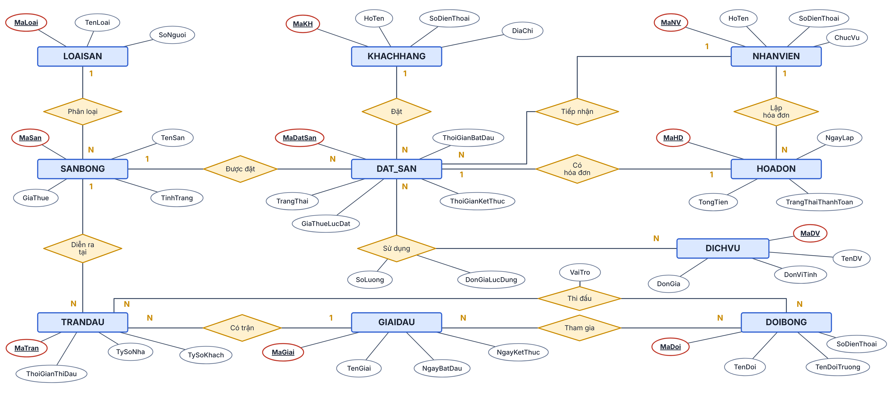
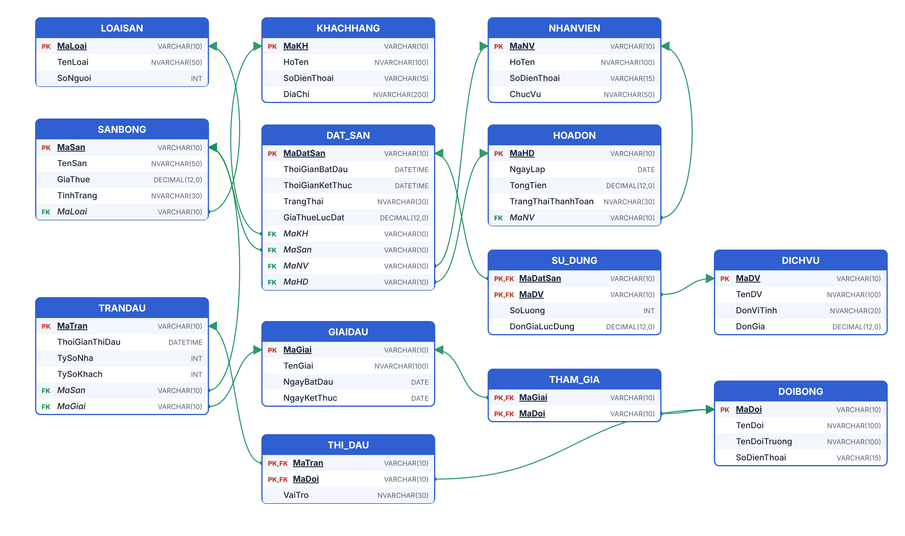

# Mini Football Field Management Database

A MySQL database project for managing mini football field bookings, services, invoices, and tournaments.

## 1. Project Overview

This project focuses on designing and implementing a relational database for a mini football field management system.

The system supports common business operations, including:

- Managing football fields and their rental prices.
- Managing customer information and field bookings.
- Managing additional services.
- Recording invoices and payment information.
- Managing teams and football matches.

## 2. Technologies and Tools

- **Database Management System:** MySQL
- **Database Design:** Entity Relationship Diagram (ERD), Relational Schema
- **Development Tool:** MySQL Workbench
- **Language:** SQL

## 3. Database Design

The database was designed based on the system's operational requirements.

The project includes:
- Entity Relationship Diagram (ERD).
- Relational schema.
- SQL scripts for creating tables and inserting sample data.
- SQL queries for retrieving and managing information.

### Entity Relationship Diagram



### Relational Schema



## 4. Repository Structure

```text
mini-football-field-management-database/
│
├── database/
│   ├── QuanLySanBong_Create.sql
│   └── QuanLySanBong_InsertData.sql
│
├── diagrams/
│   ├── er.jpg
│   └── Lược đồ quan hệ.jpg
│
├── queries/
│   └── QuanLySanBong_Querry.sql
│
└── README.md
```

## 5. How to Run

1. Install MySQL and open MySQL Workbench.
2. Open `database/QuanLySanBong_Create.sql`.
3. Execute the script to create the database and tables.
4. Open `database/QuanLySanBong_InsertData.sql`.
5. Execute the script to insert sample data.
6. Open the SQL file in the `queries/` directory to explore the example queries.

## 6. My Contribution

As a member of the project team, my main responsibilities focused on the database:

- Analyzing data requirements for the management system.
- Designing the ERD and relational schema.
- Implementing the database using MySQL.
- Creating tables, defining relationships, and inserting sample data.
- Writing SQL queries to retrieve and manage information.

## 7. Project Type

Academic group project – Database Systems course.

---

**Author:** Hoang Binh Quan  
**GitHub:** [hoangquan1701](https://github.com/hoangquan1701)
